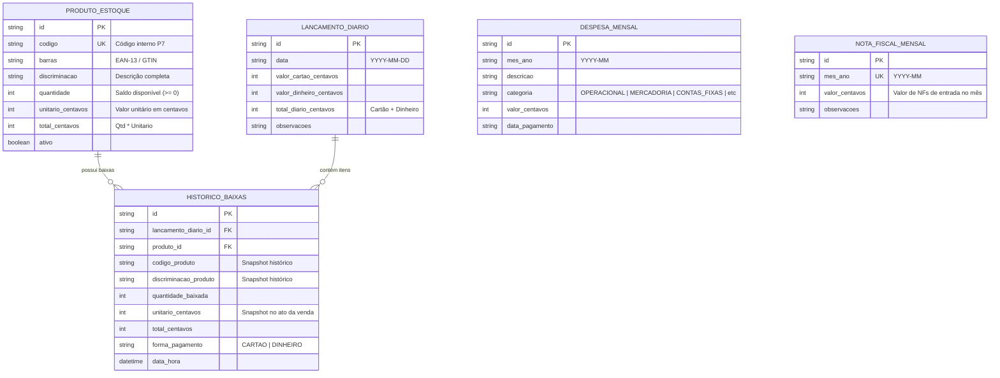

# 🏪 Mercearia POS & Dashboard Financeiro Inteligente

> **Sistema Full-Stack de Automação Comercial e Frente de Caixa (POS)** com algoritmo de baixa inteligente por valor-alvo, controle diário de vendas (**Cartão vs. Dinheiro**), conciliação fiscal mensal e ingestão de inventário contábil no padrão **Livro de Inventário Modelo P7**.

Desenvolvido por **[Iverson Santos](https://github.com/IversonSantos-dev)**.

---

## 📌 Visão Geral & Diferenciais de Engenharia

O projeto foi concebido para atender às demandas de varejo de alimentos e mercadorias, combinando alta usabilidade no balcão (Mobile First) com rigor contábil.

- **Precisão Monetária Rigorosa:** Aritmética baseada em centavos inteiros (`Int` / `BigInt`), com **zero drift de arredondamento** de ponto flutuante (IEEE-754).
- **Algoritmo de Baixa Inteligente P7:** O operador informa apenas o valor total da venda em R$ (ex: `R$ 51,80`) e a forma de pagamento; o motor consulta produtos ativos (`Qtd > 0`) e sugere combinações exatas ou unitárias ideais para debitar do estoque.
- **Redundância Híbrida (Offline-First + Nuvem Supabase):** Gravação local com failover automático e sincronização em nuvem via **Supabase**. Se a internet oscilar, a operação no balcão nunca para.
- **Mobile-First UX:** Interface pensada para uso por smartphone, teclado numérico nativo, botões rápidos de cédulas (+R$ 5 a +R$ 200), dock inferior touch (≥ 44px) e proteção rigorosa contra duplo clique em baixas.
- **Auditoria Imutável:** Cada movimentação é registrada com snapshot de preço unitário, descrição histórica e carimbo de data/hora.
- **Controle de Acesso:** Middleware de autenticação protegendo as rotas operacionais.

---

## 🚀 Demonstração & Acesso

- **Landing Page (Portfólio / SEO):** `/`
- **Frente de Caixa (POS):** `/caixa`
- **Painel Financeiro & DRE:** `/financeiro`
- **Inventário P7:** `/inventario`
- **Login Administrativo:** `/login`


---

## 🛠️ Stack Tecnológica

| Camada | Tecnologia | Descrição |
| :--- | :--- | :--- |
| **Frontend** | Next.js 15 (App Router) & React 19 | SSR, Server Components e interface reativa |
| **Estilização** | Tailwind CSS & Lucide Icons | Design moderno, responsivo e adaptado para touch |
| **ORM & Banco Local** | Prisma ORM & SQLite (WAL Mode) | Transações atômicas com alta concorrência local |
| **Banco na Nuvem** | Supabase (PostgreSQL) | Dual-write em tempo real para backup e deploy |
| **Planilhas P7** | SheetJS (`xlsx`) | Parser robusto para `.xlsx`, `.xls` e `.csv` |
| **Testes** | Vitest & React Testing Library | Suite com **404 testes automatizados** |

---

## 📐 Arquitetura do Banco de Dados



---

## 💡 Principais Módulos

### 1. Frente de Caixa & Baixa Inteligente (`/caixa`)
- Entrada de valor com acionamento do teclado numérico nativo em smartphones.
- Alternador tátil rápido entre **Cartão** e **Dinheiro**.
- Algoritmo que encontra múltiplos perfeitos ou sugere combinações ótimas de produtos ativos.
- Pop-up de revisão com detalhes da mercadoria a debitar e bloqueio imediato contra duplo clique.

### 2. Gestão de Inventário Modelo P7 (`/inventario`)
- Importação por arrastar e soltar de arquivos do Livro de Inventário Modelo P7.
- Identificação automática do cabeçalho oficial (`Código`, `Barras`, `Discriminação`, `Qtd`, `Unitário`, `Total`).
- Modo de pré-visualização (*Dry-Run*) antes da gravação definitiva.
- Catálogo paginado com busca rápida por código, descrição ou código de barras.

### 3. Painel Financeiro & DRE Mensal (`/financeiro`)
- Consolidação diária e mensal de entradas discriminadas.
- Cadastro e acompanhamento de despesas categorizadas (Fixas, Pessoal, Mercadoria, etc.).
- **Confronto Fiscal:** Comparação direta do total vendido no caixa (*Saídas*) contra as Notas Fiscais de Entrada (*Entradas*).

---

## ⚙️ Instalação e Execução Local

### Pré-requisitos:
- Node.js 20+
- `pnpm` (ou `npm` / `yarn`)

### Passos:

1. **Clone o repositório:**
   ```bash
   git clone https://github.com/IversonSantos-dev/DashboardMercearia.git
   cd DashboardMercearia
   ```

2. **Instale as dependências:**
   ```bash
   pnpm install
   ```

3. **Configure as variáveis de ambiente:**
   Copie `.env.example` para `.env`:
   ```bash
   cp .env.example .env
   ```
   *(Configure suas chaves do Supabase caso queira sincronização na nuvem).*

4. **Prepare o banco de dados:**
   ```bash
   pnpm prisma db push
   ```

5. **Inicie o servidor de desenvolvimento:**
   ```bash
   pnpm dev
   ```
   Acesse: [http://localhost:3000](http://localhost:3000)

---

## 🧪 Testes Automatizados

O projeto conta com uma suíte de **404 testes automatizados** cobrindo testes unitários, testes de integração de concorrência, tolerância a falhas e regressão:

```bash
# Executa todos os testes
pnpm test

# Executa testes em modo watch
pnpm test:watch

# Testes de cobertura
pnpm test:coverage
```

---

## 📄 Licença

Este projeto está sob licença MIT. Desenvolvido para fins operacionais e de demonstração de portfólio.
